# Keel expansion packs: the plan

Plan of Oct 18, 2026. A brainstorm turned into one plan. **Nothing here is built.** Building a pack waits until keel-engine reaches 1.0 (decision F-18). The engine was read, never changed, at `partners-pixel/keel-engine` commit `6d6cc6b` (M1 slice 4). Facts about platforms, fees, tools and laws are in [docs/SOURCES.md](docs/SOURCES.md) with their sources. The questions only you can answer are in section 11.

The rule for the whole plan: **broad in vision, modular in architecture, selective in what we build first, and driven by evidence.**

---

## 0. Summary

**The idea.** Keel's kernel already runs any kind of work that has stages, items, program checks and owner approvals. Software is the first pack. Most digital products can be packs too, if a program can check their facts and a person approves their taste and anything that goes public.

**The basic motive.** The person using the engine brings the knowledge of their field; the engine brings the way of working. Their field knowledge reaches Keel the way it does today: in the requirement and references (read-only to agents), in the planner's questions, in the decisions they type, and in project lessons. Three layers each bring one thing:
- **The person:** what to make, why, the field's rules, and the decisions about money, law, risk and taste.
- **A pack:** how to make one kind of output well, and how to check it.
- **The kernel:** how to run any work safely.

So Keel needs **few packs** (kinds of output) and serves **unlimited fields**. It does not need a universe of all knowledge before it is useful. High-stakes fields add a qualified person's review (G-EXPERT).

**Recommendation.**

| Order | Pack | Makes | Why here |
|---|---|---|---|
| 1 | `publishing` | Guides, e-books, documentation, articles, newsletters, reports | All text in git, most quality checks are programs, smallest engine change. It proves the kernel really knows no domain |
| 2 | `visual` | LinkedIn and Instagram carousels, slide decks, thumbnails, brand kits, printables | Reuses the software pack's design tools, and with pack 1 it makes most of a personal brand's weekly content |
| 3 | decided by evidence | Video is the likely third; data reports score about the same | Video needs the engine to store big media outside git first |

Four ideas are **not packs**: AI assistants and automations (software pack plus a rule set), presentations and brand kits (work kinds inside `visual`), and localization (a shared module).

**What the engine must gain first** (section 6, kept apart from pack work): packs loaded as separate plugins (E-01), evidence per work kind (E-02), an owner approval counted as an item's evidence (E-03), and shared pack modules without copies (E-13). Video adds big-file storage by hash (E-06) and owner tasks that return a file (E-07). Recurring content adds approve-once cycle templates (E-08).

**What you can start this week, without the engine:** [docs/FOUNDER-PATH.md](docs/FOUNDER-PATH.md). The packs automate later what that manual path proves works.

**Proof the sketches fit the kernel.** `packs/publishing/pack.json` and `packs/visual/pack.json`, with one stack each, pass `node tools/check-sketches.mjs`. It runs the kernel's own `checkPack` and stack schema at engine commit `6d6cc6b`. A copy with the spend gate removed fails with the kernel's own message.

---

## 1. The vision, and where Keel already stands

Your vision is a goal-driven work engine. You describe an outcome; the system finds the skills and tools, plans, executes what it may, validates, delivers and learns. A "Digital Skill Universe" sits under it: a registry of domains, capabilities, skills, tools and workflows.

Keel already holds most of the engine layers that vision names. What is missing is mostly packs and a registry, not a new engine.

| Vision layer | In Keel today (engine plan) | Missing | Whose work |
|---|---|---|---|
| A. Goals and outcomes | Requirement → PRD with an id per need; owner's success criteria judged by the verifier's acceptance mode | Goals outside software; finding which packs a goal needs | Registry + a planner "discover" mode (E-16) |
| B. Domains and capabilities | One pack per project | A registry of domains and capabilities with stable ids | Registry (section 8) |
| C. Skill knowledge | Pack skills, rule skills, role templates, lessons | Skills for each new pack | Each pack |
| D. Tools and integrations | Stack adapters, machine profiles, GitHub adapters, MCP default-deny allow-list | Tool records with licence, free-tier limits, API, privacy, freshness | Registry + each pack's stacks |
| E. Planning and orchestration | Planner, plan.json with dependencies, Team table, needs, gates, parallel worktrees | Recurring cycles; several packs in one project | Engine (E-08, E-12) |
| F. Execution | Agents in their own worktrees, check runner, profiles, rotation | Big media files; owner tasks that return a file | Engine (E-06, E-07) |
| G. Validation | Program evidence on an exact commit, blind verifier, reviewers by tag, zero checked = red | Program evidence other than `keel check`; outcome evidence after publishing | Engine (E-04, E-10) |
| H. Delivery and improvement | Merge gate, releases (M5), operate (M6), the learning loop | A publish gate checked against what went live; learning from outcomes | Engine (E-03, E-04, E-10) + packs |

Of the vision's 30 cross-cutting capabilities (X01 to X30), Keel's plan already covers 22 with a named mechanism (section 8.5). The new ones are research evidence, rights and licensing, platform rules, localization, tool discovery and monetization analysis. Most of those are pack or registry content, not engine code.

---

## 2. What a pack is, and when an idea deserves one

### 2.1 A content product in Keel's terms

| Keel idea | Software pack | A content pack |
|---|---|---|
| The product | An app in one repository | One publication, channel or catalogue in one repository |
| Source in git | Code | Markdown, HTML, SVG, scripts, edit lists, data, and a manifest of big files by sha256 |
| Build | Compile and test | A deterministic render from source, pinned tools and assets by hash: same input, same output hash |
| `keel check` | Tests, counted | Content checks, counted: claims sourced, links, specs, loudness, captions, rights. Zero checked is red |
| Review items and board | Screens at 390 and 1440 px | Sections, pieces, storyboards, cuts (low-resolution previews) |
| Merge | Code joins main | Approved content joins main |
| Release | A tag, then you press promote | An edition or drop, then you press publish (G-PUBLISH) |
| Operate | Uptime, backups, CVE report | Read-only analytics, comment triage (untrusted text), refreshes |
| Lessons | "Money always shows 2 decimals" | "Every chart cites its data file", "no text under 24 px on a carousel" |

### 2.2 The loop every content pack shares

```mermaid
flowchart LR
  S["Shape: brief, audience, budget"] --> O["Outline or inventory<br/>(approved with the plan)"]
  O --> D["Draft in small items,<br/>each on its own branch"]
  D --> C["keel check: programs count what they checked"]
  C --> R["Blind reviewers:<br/>facts, edit, critique, access"]
  R --> B["Board sitting: you approve,<br/>change or defer"]
  B --> M["keel merge"]
  M --> E["Edition or drop:<br/>full check on the tag"]
  E --> P["G-PUBLISH:<br/>you press publish"]
  P --> W["Watch: read-only analytics,<br/>lessons"]
```



### 2.3 The pack test

An idea becomes a **new pack** only when its stages, its evidence and its gates **all** differ from every existing pack. Otherwise it is one of these:

| It differs only in | It becomes | Example |
|---|---|---|
| Tools | A stack | Pandoc or a static site generator for the same publication |
| Extra rules for some projects | A rule set inside a pack | The software pack's multi-tenant rule set; a new "agent" rule set for AI automations |
| A part many packs use | A shared module (needs E-13) | Rights manifest, fact-checker, TAP reporter, design core, localization |
| One more kind of output | A work kind | Research report inside `publishing`; deck inside `visual` |
| A mix of packs | A composite plan (needs E-12) | An online course: text, slides and video lessons |

This test keeps the library from growing into many shallow packs.

### 2.4 Rules every content pack keeps (the content baseline)

These hold in every content pack. A project may tighten them; loosening one needs G-LOOSEN.

- **C-1 Fictional data.** Examples, previews and fixtures use made-up people, companies and numbers. A personal-data scan runs before anything is merged or published.
- **C-2 Sources are evidence.** A web page or document an agent relies on is saved as a snapshot with its sha256 under `sources/snapshots/` (protected). It is fenced as untrusted text and can never instruct an agent.
- **C-3 Every claim is sourced.** `claims.json` ties each factual sentence to a source id. The fact-checker passes a claim only when the snapshot says it.
- **C-4 Every borrowed thing is licensed.** `rights.json` lists each image, font, icon, music track, quote and voice with its licence id (SPDX or Creative Commons where one exists) and source. No licence, no use.
- **C-5 AI is disclosed where required.** Each item records which parts are AI-made. Programs check that the disclosure the channel or law requires is set: EU AI Act Article 50 labels for realistic synthetic media, YouTube's `containsSyntheticMedia`, TikTok's `is_aigc`, and disclosures on Amazon KDP, Etsy and Udemy. Canva Creators does not accept AI-generated content at all. C2PA metadata is kept intact.
- **C-6 Agents never publish or pay.** No agent holds a publishing, payment or account token. Publishing is a physical owner action (G-PUBLISH), which also fits each platform's own hand-off: a private YouTube upload you make public, a TikTok inbox draft you finish in the app.
- **C-7 High-stakes topics get a professional.** A section tagged `regulated` (health, money, law, tax) cannot close until you approve G-EXPERT, after a qualified person has reviewed that exact text.
- **C-8 Your voice and face only with consent on file.** A voice clone or likeness needs a consent record. Another person's voice or likeness is never used without their written consent.
- **C-9 No fake social proof.** No invented reviews, testimonials or AI reviewers (the US FTC rule in force since Oct 2024). Paid relationships are disclosed clearly.
- **C-10 Original work, low volume.** YouTube (since Jul 2025), Meta, X and TikTok refuse to pay for mass-produced or templated content. Packs plan few items, each with your own view in it, and never bulk output.
- **C-11 Outside costs are counted.** Generation credits, fonts and stock count against a budget. Any new paid service goes through G-SPEND.

---

## 3. The candidates

Fifteen ideas, each in the same shape. **Effort** is in *slices*: one slice is one pull request of checked work, and an engine session usually lands 2 to 4. "E-xx" points to the engine register in section 6.

### Family: text

#### 1. Publishing: guides, e-books, documentation, knowledge bases, reports, article and newsletter series

- **Makes:** a static documentation or knowledge site, an e-book (EPUB and PDF), a report, an article series or a newsletter issue, all built from Markdown in git with pinned tools.
- **Stages:** shape → outline → draft → edit → proof → publish → done.
- **Work items:** `section` (a chapter, article or page), `figure` (a diagram as code, a table, a chart from a data file), `edition` (one versioned release: the site, the EPUB, the PDF, or one newsletter issue). A research report is a section kind with a stricter claims rule, not a separate pack.
- **Programs check:** the build succeeds from source; every claim has a source whose snapshot hash matches; internal links resolve (offline), external links in a heavy step; style and spelling rules (Vale); reading level inside the brief's band; structure rules (each chapter has a summary, each heading level in order); code samples compile and run (tag `code`); the EPUB passes EPUBCheck and Ace by DAISY; every image has alt text; `rights.json` covers every figure and quote; the personal-data scan; the AI disclosure line where the channel needs one.
- **You approve:** G-PLAN (the brief, audience, outline and budget as one decision); G-READ sittings (chapter reads on the board: `C03 ok`, `C05 change: shorter intro`); G-EXPERT for `regulated` sections; G-PUBLISH (you upload or press publish); G-SPEND; G-CHANGE.
- **Agents:** kernel planner (with an outline mode), verifier, diagnoser, curator. Pack: `writer` (fallback doer), `fact-checker`, `line-editor`, `access-reviewer`. Role templates: `author` (slots: voice, audience, reading level, style guide), `technical-author` (code samples in the project's languages), `illustrator` (diagrams as code).
- **Needs from the engine:** E-01, E-02, E-03, E-13. E-04 and E-05 make the reading board and the "published equals approved" check real.
- **Effort:** about 10 pack slices (3 to 4 sessions), after about 7 to 9 engine slices (2 to 3 sessions).
- **Value:** your own guides and articles now; paid guides, lead magnets and documentation as a service; the base for courses, newsletters and reports. Keel's checks matter here: facts, links and rights are where written products fail.
- **Verdict: first pack.** Full design in section 5.1.

### Family: still visuals

#### 2. Visual: carousels, thumbnails, social graphics, printables

- **Makes:** LinkedIn document carousels (PDF), Instagram carousels (up to 10 items) and posts, YouTube thumbnails, social graphics, printables, all written as HTML and SVG from shared tokens and rendered by a pinned headless browser to exact sizes.
- **Stages:** shape → direction → compose → review → export → publish → done.
- **Work items:** `kit` (tokens, components, templates), `piece` (one carousel, thumbnail set, deck or printable), `drop` (a batch published together, such as a week of posts).
- **Programs check:** only tokens are used (no raw colours or sizes); contrast meets WCAG AA; no text below the size floor at phone display size; no overflow or clipped text; exact channel sizes, page counts and file-size limits; safe areas; fonts embedded and licensed; rights, including which images are AI-made; no real people or data; the same source renders to the same hash.
- **You approve:** G-PLAN; G-FINAL sittings on the board, the first one picking the visual direction (`direction B`, `P03 ok`); G-PUBLISH; G-SPEND (fonts, stock images); G-CHANGE.
- **Agents:** `designer` (modes: kit, direction, compose), `design-critic` (blind), `line-editor` and `fact-checker` (shared with publishing), `maker` (fallback).
- **Needs from the engine:** E-01 to E-05 and E-13. The design core (tokens in DTCG format, kit, renderer, critic, board, freeze and final-stale) comes from the software pack's M2 design stage and becomes a shared module.
- **Effort:** about 9 pack slices; most tools are reused from M2.
- **Value:** the weekly content of a personal brand on LinkedIn and Instagram; thumbnails for video later; decks for sales; templates to sell later.
- **Verdict: second pack.** Presentations and brand kits fold in. Full design in section 5.2.

#### 3. Presentations

- **Makes:** pitch, sales, training and talk decks with speaker notes, exported to PDF and PPTX (Marp or Slidev).
- **Stages, items:** those of `visual`; work item `deck`.
- **Programs check:** words per slide under a limit; minimum font size; contrast; speaker notes on every slide; every chart drawn from a data file; talk length from the notes (words ÷ speaking rate) inside the slot.
- **You approve:** a G-FINAL sitting per deck; you give the talk yourself.
- **Agents:** `designer` (deck mode), `line-editor`, `fact-checker`.
- **Needs from the engine:** as `visual`.
- **Effort:** 2 to 3 slices inside `visual`.
- **Value:** medium; useful for sales calls and talks.
- **Verdict: a work kind and a stack inside `visual`.** It fails the pack test: same stages, same gates.

#### 4. Brand and design kits

- **Makes:** a colour and type system as tokens, logo files and usage rules, components, templates.
- **Programs check:** the token build; contrast across every text and background pair; logo files in every size and format; clear-space rules rendered; font licences.
- **You approve:** the direction (G-FINAL). Names and trademarks are legal questions: a person decides, with professional advice, never an agent.
- **Needs from the engine:** as `visual`.
- **Effort:** 2 slices inside `visual`.
- **Value:** reused by every visual piece, and by the software pack's screens.
- **Verdict: the `kit` work kind inside `visual`.** Its tooling becomes the shared design core (E-13).

#### 5. Digital templates to sell

- **Makes:** Notion systems, spreadsheet tools, Canva or Figma templates, printable planners, developer starter kits (for example a .NET and AI starter repository).
- **Stages:** shape → make → test → package → list → sell → support.
- **Work items:** `template`, `listing` (title, description, previews, price), `bundle`.
- **Programs check:** formulas give the right results on fixture data (LibreOffice headless for spreadsheets); the template opens and duplicates cleanly; links work; a licence file is included; previews are rendered from the template itself; listing rules (AI disclosure on Etsy; Canva rejects AI-generated work; no fake reviews).
- **You approve:** the price (money), the marketplace and its terms, G-PUBLISH (you list it), every reply to a buyer.
- **Agents:** `maker`, a fixture tester, `line-editor`.
- **Needs from the engine:** E-01 to E-03; E-10 to read sales.
- **Effort:** 8 to 10 slices.
- **Value:** medium. Templates sell to an audience you already have. Fees run from about 5% to 10% plus a fixed fee per sale (Gumroad, Payhip, Lemon Squeezy, Notion Marketplace).
- **Verdict: later.** Test demand by hand first: one template, one listing, one month.

### Family: time-based media

#### 6. Video and YouTube

- **Makes:** long-form explainers, Shorts (square or vertical, up to 3 minutes), screen-recorded tutorials, narrated videos without a face on screen, course lessons.
- **Stages:** shape → script → storyboard → produce → cut → finish → publish → watch → done.
- **Work items:** `script`, `storyboard` (shots, timings, assets), `asset` (voice, footage, music or image, stored by hash), `cut` (an edit list rendered by FFmpeg, Motion Canvas or MoviePy), `finish` (captions, chapters, thumbnail, description), `episode` (the release).
- **Programs check:** the render is reproducible from the edit list and assets by hash; ffprobe specs (resolution, frame rate, codec, duration limits); loudness and true peak at the target; no black or frozen frames over a threshold; captions present, valid, in sync (forced alignment) and under a reading-speed limit; script claims sourced; rights and consent for every asset; the synthetic-media flag set when realistic AI content is used; thumbnail size and legibility.
- **You approve:** G-PLAN (the series); G-FINAL sittings on the storyboard and the cut, with low-resolution previews; G-PUBLISH (you make the private upload public, with the disclosure set in YouTube Studio); G-SPEND (generation credits); owner tasks such as "record the voice-over for E03".
- **Agents:** `scriptwriter` (role), `storyboarder`, `editor` (writes the edit list), `video-critic` (vision), `fact-checker`; captions and specs are mostly programs.
- **Needs from the engine:** E-06 (big files by hash), E-07 (owner tasks that return a file), E-09 (outside spend), E-05 with previews under the 16 MB board limit; E-10 later.
- **Effort:** about 16 to 20 pack slices, plus about 7 engine slices.
- **Value:** the highest reach and money potential; reuses `visual` (thumbnails) and `publishing` (scripts, sources).
- **Risks:** monetization refuses mass-produced and templated content (since Jul 2025); uploads from unaudited API projects stay private, which suits "you press publish" anyway.
- **Verdict: likely third,** once the media engine features exist.

#### 7. Podcasts and audio

- **Makes:** episodes, short clips, show notes, transcripts, an RSS feed.
- **Stages:** shape → outline → record (an owner task) or synthesize → edit → master → publish → done.
- **Programs check:** loudness at −16 LKFS ±1 dB and true peak no higher than −1 dBFS (Apple's audio requirements); file format; a valid RSS feed (a GUID that never changes, enclosure length and type); transcript present; chapters valid; show-note links.
- **You approve:** G-PUBLISH, voice consent, and each guest's release form (a person collects it).
- **Agents:** `producer` (outline and show notes), `audio-editor` (edit list), `fact-checker`.
- **Needs from the engine:** E-06, E-07.
- **Effort:** 8 to 10 slices on top of the video media core.
- **Value:** medium; free hosting exists (Spotify for Creators).
- **Verdict: after video,** sharing its media core.

### Family: distribution and growth

#### 8. Social media operations

- **Makes:** a running content calendar across LinkedIn, Instagram, X and others; repurposed posts; reply drafts; a weekly report. The posts themselves are made by `publishing` and `visual`.
- **Stages (while live):** plan the month → produce → schedule → publish → watch → learn.
- **Work items:** `calendar` (a cycle template), `post` (copy plus a piece), `reply-draft`, `report`.
- **Programs check:** each platform's limits (characters, image counts, sizes); links; disclosures for paid partnerships; no fake reviews; cadence kept; every post traced to a calendar slot; analytics read through read-only scopes.
- **You approve:** the monthly calendar once (E-08); each week's posts as one G-PUBLISH decision; every reply that goes to a person.
- **Agents:** `strategist` (a planner mode), `repurposer`, `reply-drafter` (it reads untrusted comments), `analyst`.
- **Needs from the engine:** E-08 (recurring cycles), E-10 (outcomes), E-14 (comments as an untrusted channel).
- **Effort:** about 10 slices on top of packs 1 and 2.
- **Value:** high for a brand, but the production half is already packs 1 and 2.
- **Verdict: fourth.** It is the distribution layer, not the production layer.

#### 9. Marketing and client pipeline

- **Makes:** an offer page, prospect lists from public business information, outreach drafts, a follow-up schedule, an intake form that turns into a requirement brief, proposal drafts, email sequences.
- **Stages:** define the offer → find → reach out → follow up → qualify → propose → won or lost.
- **Work items:** `prospect-batch`, `message-draft`, `follow-up`, `intake-brief`, `proposal`.
- **Programs check:** each message has a real, sourced reason to contact that person; no false claims; marketing email carries an opt-out and a postal address (CAN-SPAM); EU rules need prior consent for marketing email; your daily caps hold; nobody is messaged twice; follow-up dates are kept; prices come only from your rate card.
- **You approve:** every message (you press send), every price, every proposal. In Keel's planned delivery mode a signed scope is gate G-COMMIT (keel-engine PLAN section 3).
- **Agents:** `researcher`, `copy-drafter`, `intake-analyst` (a call transcript becomes a brief), `proposal-drafter`.
- **Needs from the engine:** E-11 first. Prospects are real people, and Keel's founding rule is that no real client data reaches the AI. Then E-08, E-10 and delivery mode.
- **Effort:** 10 to 14 slices, after a written data policy.
- **Value:** very high for you: finding clients is your bottleneck.
- **Risks:** LinkedIn's user agreement forbids bots and automated messaging, and losing your account would cost the one channel you need. The pack would draft and remind; you send.
- **Verdict: do it by hand with Claude now** ([FOUNDER-PATH](docs/FOUNDER-PATH.md)). Build the pack only after a data policy exists and the manual work shows what repeats.

### Family: composites and learning

#### 10. Online courses

- **Makes:** a curriculum, lessons (text, slides, video), quizzes, assignments, and a course site or an upload to a course platform.
- **Stages:** validate → objectives → curriculum → lessons → assessments → pilot → publish → improve.
- **Programs check:** every learning objective has a lesson and an assessment item, traced like requirement ids; answer keys are consistent; reading level; accessibility; the video checks from pack 6; pilot learners' results as outcome evidence, with their consent.
- **You approve:** the curriculum (G-PLAN), lesson reads, the price, the platform (fees range from 0% on your own static site to platform plans with monthly fees), G-PUBLISH.
- **Agents:** `instructional-designer` (planner mode), plus the agents of packs 1, 2 and 6.
- **Needs from the engine:** E-12 (several packs in one project), E-10.
- **Effort:** 6 to 8 slices on top of packs 1, 2 and 6.
- **Value:** high, but only once you know what your audience asks for.
- **Verdict: a composite after packs 1 and 2** (text and slides); video lessons after pack 6.

#### 11. Personal learning programs (for example, spoken English for explaining technical work)

- **Makes:** a personal plan from a starting assessment, daily practice sessions, exercises with answer keys or rubrics, assessments, progress reports.
- **Stages:** assess → plan → practise daily → assess again → adapt.
- **Work items:** `session`, `assessment`, `review`.
- **Programs check:** each session targets a gap from the last assessment; every exercise has a key or a rubric; progress comes from assessments, never from how much material was generated; the rate of repeated mistakes, which is Keel's own recurrence measure.
- **You approve:** goals and schedule. Your learning data stays private.
- **Agents:** `tutor` (a role), an `assessor` checked against rubrics.
- **Needs from the engine:** E-08 (daily recurrence) and E-11 (your own personal data). A live daily conversation also fits Keel's branch-and-merge loop poorly.
- **Effort:** large, and a poor fit with what Keel does best.
- **Value:** high for you personally.
- **Verdict: run it by hand now** as a Claude Project with a mistakes log ([FOUNDER-PATH](docs/FOUNDER-PATH.md) section 7). Consider a pack only if the record-keeping proves valuable. Keel's strength is checked work products, not live tutoring.

### Family: data and operations

#### 12. Data reports and dashboards

- **Makes:** recurring reports, dashboards and analyses as notebooks that re-run from raw data.
- **Programs check:** data tests (schema, nulls, ranges, freshness) with dbt tests, Great Expectations or Frictionless; a re-run from raw data gives the same numbers; every chart comes from a query in git; totals reconcile to the source; no personal data in outputs.
- **You approve:** metric definitions, and publishing any number.
- **Agents:** `analyst` (a role), plus the verifier and a data reviewer.
- **Needs from the engine:** E-11 (agents may work only on fixtures, so real runs happen in your own environment), E-08, E-04.
- **Effort:** about 10 slices.
- **Value:** strong checks, real demand from businesses.
- **Verdict: later.** A live dashboard is software, so most of this is a software-pack project; a recurring analysis report could become a `publishing` work kind.

#### 13. AI assistants and automations

- **Makes:** chat assistants, agents with tools, n8n or Make workflows, email and WhatsApp bots for small businesses.
- **Programs check:** pass rate on a golden set of example inputs; one prompt-injection test per input channel; every outside action goes through an approval step or a sandbox dry run; cost per run under a cap; out-of-scope requests refused.
- **You approve:** connecting to any real account (production, G-PROD), the client's acceptance.
- **Agents:** the software pack's, with the `ai-features` role and the `ai-safety` rule skill that ship in M1.
- **Needs from the engine:** none beyond the software pack, plus an "agent" rule set and stacks (n8n workflow JSON, .NET), proposed after 1.0 as an engine proposal.
- **Effort:** 4 to 6 slices of rule set and stacks.
- **Value:** high, and the closest fit to a .NET developer's paid services.
- **Verdict: not a pack.** It is software: a rule set and stacks inside the software pack.

#### 14. Localization

- **Makes:** translated text, subtitles, localized graphics, app strings.
- **Programs check:** placeholders and tags kept; ICU message syntax valid; length limits; glossary terms used; date, number and currency formats; no untranslated strings. An agent back-translates a sample. A person reviews public legal text.
- **You approve:** target languages; legal text through a person.
- **Agents:** a `translator` role and a reviewer.
- **Needs from the engine:** E-13 (shared modules).
- **Effort:** 3 to 4 slices as a module.
- **Value:** extends every pack's audience.
- **Verdict: a shared module and work kind** used by publishing, visual, video and the software pack.

#### 15. Game content

- **Makes:** level data, dialogue trees, item tables, quest text.
- **Programs check:** schema validation; every level and dialogue node reachable; no dead ends; balance simulations inside bands.
- **You approve:** the design direction and each release.
- **Agents:** a `content-designer` role and a balance checker.
- **Needs from the engine:** E-01 to E-03.
- **Effort:** about 8 slices.
- **Value:** well checkable, but far from your goals.
- **Verdict: parked.**

---

## 4. Ranking

### 4.1 How we scored

Each idea gets 1 to 5 on four value and five feasibility questions.

| Value | Question | Feasibility | Question (5 = easiest) |
|---|---|---|---|
| V1 | Does the owner need it now (brand, clients, own projects)? | F1 | How little must the engine gain first? |
| V2 | Can it earn money, directly or as a service? | F2 | How much of "good" can a program check? |
| V3 | How many later packs reuse it? | F3 | How low are platform, legal and account risks? |
| V4 | How much do Keel's checks add (mistakes that are costly and checkable)? | F4 | How small is the pack itself? |
| | | F5 | How well does it fit Keel's limits (git, fixtures only, small budget, slow PC)? |

**Score = mean value × mean feasibility** (at most 25). These are judgments, not measurements. They become measurements after the first pack's bench (section 7), and the order after pack 2 is set by that evidence.

### 4.2 Scores

| Rank | Idea | V1 | V2 | V3 | V4 | F1 | F2 | F3 | F4 | F5 | Value | Feas. | Score | Becomes |
|---|---|---|---|---|---|---|---|---|---|---|---|---|---|---|
| 1 | Publishing | 5 | 4 | 5 | 4 | 5 | 4 | 5 | 4 | 5 | 4.5 | 4.6 | **20.7** | Pack 1 |
| 2 | Visual | 5 | 4 | 5 | 3 | 4 | 4 | 4 | 4 | 5 | 4.25 | 4.2 | **17.9** | Pack 2 |
| – | Localization | 2 | 3 | 5 | 4 | 4 | 5 | 4 | 4 | 4 | 3.5 | 4.2 | 14.7 | Module |
| – | Brand kits | 3 | 3 | 5 | 3 | 4 | 4 | 4 | 4 | 5 | 3.5 | 4.2 | 14.7 | Inside visual |
| – | AI automations | 4 | 5 | 3 | 5 | 4 | 4 | 3 | 3 | 2 | 4.25 | 3.2 | 13.6 | Software rule set |
| – | Presentations | 3 | 3 | 3 | 3 | 4 | 4 | 5 | 4 | 5 | 3.0 | 4.4 | 13.2 | Inside visual |
| 3 | Data reports | 2 | 4 | 3 | 5 | 3 | 5 | 4 | 3 | 2 | 3.5 | 3.4 | 11.9 | Later; mostly software |
| 4 | Video | 5 | 5 | 4 | 4 | 2 | 3 | 3 | 2 | 3 | 4.5 | 2.6 | 11.7 | Likely pack 3 |
| 5 | Courses | 4 | 5 | 3 | 4 | 2 | 3 | 4 | 1 | 4 | 4.0 | 2.8 | 11.2 | Composite |
| 6 | Social operations | 5 | 4 | 3 | 3 | 2 | 3 | 2 | 3 | 3 | 3.75 | 2.6 | 9.8 | After video |
| 7 | Templates to sell | 3 | 4 | 2 | 3 | 3 | 3 | 3 | 3 | 4 | 3.0 | 3.2 | 9.6 | Later |
| 7 | Podcasts | 3 | 3 | 3 | 3 | 2 | 4 | 4 | 3 | 3 | 3.0 | 3.2 | 9.6 | After video |
| 9 | Learning programs | 5 | 3 | 3 | 4 | 1 | 3 | 3 | 2 | 2 | 3.75 | 2.2 | 8.3 | By hand first |
| 10 | Game content | 1 | 3 | 2 | 3 | 3 | 4 | 4 | 3 | 4 | 2.25 | 3.6 | 8.1 | Parked |
| 11 | Client pipeline | 5 | 5 | 3 | 3 | 2 | 3 | 1 | 3 | 1 | 4.0 | 2.0 | 8.0 | By hand first |

### 4.3 The recommendation

**First: `publishing`.**
1. It needs the smallest engine change of any real pack: loading packs from outside the kernel's folder, plus the per-kind evidence and gate evidence the software pack's own release work needs anyway (E-01 to E-03).
2. Its stages, evidence and gates differ from software, so it truly tests the kernel's domain-neutral seam. The engine plan asks for exactly that test when a second pack starts.
3. Everything is text in git. No big files, no outside accounts, no platform API.
4. Programs can check most of what makes a written product good or bad.
5. You can use it at once: a guide about what you know, long articles for LinkedIn, a newsletter. It also feeds every later pack (scripts for video, lessons for courses).

**Second: `visual`.** With `publishing` it makes most of a personal brand's weekly content (posts, articles, carousels), and it reuses the software pack's M2 design stage.

**Why not video first?** It has the highest value, but it needs four engine features first (big files by hash, owner tasks that return a file, outside spend, media previews). Building them for the first non-software pack would mix two risks: a new domain and a new storage layer.

**Why not the client pipeline first,** when finding clients is your biggest need? It handles real people's data, which Keel's founding rules keep away from the AI. And LinkedIn forbids automated messaging. The manual path in FOUNDER-PATH gets you clients sooner than any pack could, and shows what a pack should later automate.

---

## 5. The first two packs in detail

### 5.1 `publishing`

**A project's layout.**

```
<publication>/ (main)
├─ keel.config.json            pack: publishing, stack: pub-markdown
├─ requirements/               your brief and references (read-only to agents)
├─ outline/                    outline.json (sections, ids, audience, done-when), final/ (approved, protected)
├─ manuscript/                 one Markdown file per section
├─ figures/                    diagrams as code, charts from data/
├─ sources.json                 source ids → URL or document, snapshot sha256, date read
├─ sources/snapshots/          saved copies by hash (protected; untrusted text)
├─ claims.json                 claim id → section, sentence, source id, quote span
├─ rights.json                 asset or quote → licence id, source, AI-made yes or no
├─ checks/                     project checks (node --test): structure rules, lessons as tests
├─ styles/                     Vale style rules (house voice, banned words)
└─ build/                      git-ignored output: site, EPUB, PDF
```

**One section, start to finish.** The planner's outline mode turns your brief into `outline.json` with section ids (C01, C02 ...), each with 2 to 5 done-when lines, approved with G-PLAN. `keel next` starts C03 on its own branch. The `author` agent writes a 10-line care plan: claims it will make, sources it needs, the checks it will add. Then it drafts and commits. `keel check` runs the stack's steps. The fact-checker, line editor and verifier judge the real diff blind. One fix round follows. The section appears on the board for your next reading sitting, and you type `C03 ok`. Then `keel merge`.

**Checks and their thresholds** (all count what they checked; nothing checked fails):

| Step | Checks | Threshold source |
|---|---|---|
| build | Site, EPUB and PDF build from source with pinned tools | Exit code |
| structure | Project checks: heading order, summaries, section done-when lines, lessons | `checks/*.test.mjs` |
| claims | Every claim has a source; snapshot hashes match; no orphan source | `claims.json`, `sources.json` |
| rights | Every figure and quote has a licence entry; AI-made marked | `rights.json` |
| prose | House style and spelling | `styles/` |
| links | Internal links offline; external links (heavy) | lychee |
| personal-data | No real-looking names, emails, phone numbers or ids in examples | Pack scanner (the kernel's personal-data shapes plus names) |
| epub (heavy) | EPUB validity | EPUBCheck |
| access (heavy) | EPUB accessibility | Ace by DAISY, WCAG 2.x |

**Today's kernel against the sketch.** The sketch passes `checkPack` today. That proves the shape fits; it does not mean the kernel would enforce every line.

| Enforced by the kernel now | Declared, but read only after an engine change |
|---|---|
| Nine never-default gates, with the five purposes the kernel requires | `producers`, `commands`, `modules`, `plannerModes`, `reviewKinds` (read from M2 onward: E-04, E-05) |
| `check`, `verify` and `merged` on every item; extra evidence by tag (`facts` → `review.facts`, `regulated` → facts and edit) | Close entries with `?`: `gate.G-EXPERT@head?regulated`, `gate.G-PUBLISH@tag?edition`, `published.match@tag?edition`. The kernel skips these in its consistency check and does not enforce them yet (E-02, E-03) |
| Every reviewer is a listed checker | Loading the pack from outside the kernel's own folder (E-01) |
| Lesson proofs over `node --test` titles; protected paths; policy lines injected into briefs | — |

**Bench `tiny-guide`.** A five-section guide on a made-up topic, with fictional data and scripted owner answers. It has four planted defects: an unsourced claim, a broken internal link, a real-looking email address in an example, and a figure with no licence. **Pass:** every defect is caught before merge; 0 false greens; the planted unsourced claim becomes a lesson that a later section's brief selects; at most 5 owner decisions.

**Slices (about 10, after the engine items).**

| # | Slice | Done when |
|---|---|---|
| P1 | pack.json, outline, claims, sources and rights schemas | `checkPack` passes; each schema rejects a broken fixture |
| P2 | TAP reporter, `tap` parser, claims and rights checks | Each check fails on its planted defect and counts what it checked |
| P3 | Wrappers for Vale, lychee, EPUBCheck, Ace; the personal-data check | Each wrapper is red on a planted defect and red when nothing was checked |
| P4 | Agents: writer, fact-checker, line-editor, access-reviewer | Agent lint passes; the fact-checker fails a claim whose snapshot lacks it |
| P5 | Role templates author, technical-author, illustrator | `keel team generate` fills them with no placeholder left |
| P6 | Section, figure and edition skills | The run skill drives one section end to end in a fixture |
| P7 | Planner outline mode | A brief becomes an outline that passes plan lint |
| P8 | Section preview renderer for the board | A sitting freezes two sections and returns one for changes |
| P9 | Edition command and published-match check | A changed file after G-PUBLISH is reported as an incident |
| P10 | Bench `tiny-guide` and its evals | The bench passes as above |

### 5.2 `visual`

**What a piece is.** One HTML file per page or frame, drawn only from `brand/tokens.json` and the kit, with fixture data. `specs.json` names each output: channel, size, pages and file-size limit. The renderer turns them into PNG and PDF in a pinned headless browser, the same way the software pack's design stage captures screens.

**Board sittings.** The first sitting shows 2 or 3 directions on the same pieces (`direction B`). Later sittings show pieces at their real size and at phone size, with the same answer lines as screens: `P03 ok`, `P05 change: bigger headline`, `pattern: one idea per slide`. A pattern becomes an automatic check where it can.

**Checks.**

| Step | Checks |
|---|---|
| tokens | No raw colour, size or font in any piece; the token build hash matches |
| render (heavy) | Every spec renders; the same source renders to the same hash |
| specs (heavy) | Exact sizes, page or item counts (for example at most 10 items in an Instagram carousel), file-size limits, safe areas |
| legibility (heavy) | Contrast WCAG AA (4.5:1 for body text, 3:1 for large text); no text under the floor at phone size; no overflow or clipping |
| rights | Fonts, images and icons licensed; AI-made images marked |
| personal-data | No real people, names or data in pieces or previews |
| structure | Project checks and lessons as tests |

**Bench `tiny-carousel`.** A 6-slide carousel and one thumbnail for a made-up brand. It has four planted defects: a raw colour, a slide with text below the floor, a font with no licence entry, and a real-looking face photo with no rights line. **Pass:** all caught before merge; 0 false greens; the board stays under 16 MB; at most 4 owner decisions.

**Slices (about 9, after the engine items and the shared design core).** V1 pack.json and specs schema · V2 renderer wrapper and specs check · V3 tokens and legibility checks · V4 rights and personal-data checks (shared with publishing) · V5 designer modes and maker · V6 kit, piece and drop skills · V7 piece inventory planner mode · V8 board renderer for pieces · V9 bench `tiny-carousel`.

---

## 6. What the Keel engine must gain

These items are **engine work**, kept apart from pack work. Each enters keel-engine only as an owner-approved engine change (G-ENGINE), after 1.0, and only when a pack's bench shows the need (keel-engine Principle 15). "In the engine plan" says whether keel-engine's PLAN already expects it.

| Id | What | Why (which packs) | Smallest form | Needed before | In the engine plan? | Proven by | Slices |
|---|---|---|---|---|---|---|---|
| E-01 | Packs as separate plugins, loaded from outside the kernel's folder | Every new pack (`loadPack` reads only the plugin's own `packs/<id>`) | Split into `keel` and `keel-software`; a pack found by plugin path; a toy pack tests the seam | Pack 1 | Yes: deferred until a second real pack starts | Install smoke with two plugins; the toy pack's walk test | 3–4 |
| E-02 | Evidence per work kind | An `edition` needs gate evidence a `section` does not; today `"*"` applies to every item and the rest only by tags the planner must remember | `workKinds.<kind>.evidence`, joined with `"*"` | Pack 1 | Implied: PLAN's release kind closes on evidence the current `checkPack` would refuse | A ratchet test; a release-kind fixture | 1 |
| E-03 | An owner approval as item evidence (`gate.G-X@subject`) | G-EXPERT, G-PUBLISH | Close refuses until the gate is approved for that exact hash | Pack 1 | Yes, for G-RELEASE at M5 | A fixture whose item cannot close without the typed line | 1–2 |
| E-04 | Program evidence beyond `keel check` | Published-match, conformance, specs | `producers` read by the kernel; sealed and harness-observed like `keel check` | Pack 2 | Yes, for design conformance at M2 | A forged producer result is refused | 2 |
| E-05 | Review items and boards for any review kind | Sections, pieces, storyboards, cuts | The M2 board kept generic; the renderer is the pack's | Pack 1 board, pack 2 | Yes, M2 (screens); the purity lint keeps it generic | Two review kinds on one board in a fixture | 1–2 |
| E-06 | Big files by hash outside git | Video, podcasts, large visual exports | A content-addressed store adapter (put, get, verify sha256) over an S3-compatible API or GitHub Release assets; `blob:sha256` evidence subjects; a manifest in git; a check prepare step that fetches by hash; a retention rule | Video | No: new | A changed blob fails the check; a missing blob is red, never skipped | 4 |
| E-07 | Owner tasks that return a file | Record a voice-over, provide footage, upload a signed expert review | A need whose answer is an asset hash, bound like a gate subject | Video, podcasts | Partly (needs; decision D-06) | A fixture where an agent-made file cannot answer an owner task | 2 |
| E-08 | Recurring cycles approved once | Social operations, newsletter series, learning | A cycle template approved with G-PLAN; each instance runs without a new plan approval; every publish still waits for G-PUBLISH; pause per series | Pack 4 | No: new | Instances refuse to start after the template's hash changes | 3 |
| E-09 | Outside spend counted | Generation credits, stock, fonts | Cost lines for outside services, a budget per cycle, the usage guard covering them | Video | G-SPEND yes; counting no | Over budget pauses the item | 1 |
| E-10 | Outcome evidence | Views, replies, sales after publishing | Read-only metric snapshots tied to a published item (L0 only); experiments whose results the owner judges | Pack 4 | Partly (L0 telemetry at M6) | A snapshot with personal data is refused | 2–3 |
| E-11 | A rule for packs that must touch real personal data | Client pipeline, learning, data reports | An owner decision first (a written data policy, with a lawyer where needed); then data minimisation, real-data paths and scans | Pipeline, learning | No: today's rule is "no real client data reaches the AI" | Decided before any code | — |
| E-12 | Several packs in one project | Courses, a creator business | One repository per pack at first; composition only on evidence | Courses | No | — | 3+ |
| E-13 | Shared pack modules without copies | Rights, fact-checker, TAP reporter, design core | A library plugin that packs load, hash-pinned like the kernel | Pack 1 | No (Principle 10 forbids copies) | Drift of a shared module blocks merges | 2 |
| E-14 | New untrusted channels | Audience comments, messages, analytics text, web sources | Fences and one injection eval per channel | Packs 1 and 4 | Yes: M1 evals per channel; add channels | The eval expects no tool action | 1 |
| E-15 | Publishing through APIs | Only if you ever want scheduled posting without pressing publish | A write intent kind per platform, at action level L1 | Never by default | L1 is off (F-14) | — | — |
| E-16 | A planner "discover" mode | Goals outside software | The planner reads the registry (section 8) and proposes packs, skills and tools, with gaps | After pack 2 | No | A fixture goal maps to the expected packs | 2 |

**Before pack 1:** E-01, E-02, E-03 and E-13, about 7 to 9 slices. E-05 matters too, but it arrives with M2.

---

## 7. Roadmap

Each step starts only when the one before has passed its checks. The order after step X2 is decided by evidence.

| Step | When | Scope | Done when (checkable) |
|---|---|---|---|
| **X0** | Now, before engine 1.0 | This repository: plan, showcase, sketches, registry design. You run FOUNDER-PATH by hand | Your answers to section 11 are recorded; sketches pass `check-sketches.mjs`; your repeat log (FOUNDER-PATH section 6) lists the tasks you did three times or more |
| **X1** | After 1.0, with F-18 asked | Engine E-01, E-02, E-03, E-13 (and a toy pack); then pack `publishing` 0.1 | Bench `tiny-guide` passes with 0 false greens; your first real guide or article series is published by you; at most 5 owner decisions in its first cycle |
| **X2** | After X1 | E-04 and E-05 generalized; shared design core; pack `visual` 0.1 | Bench `tiny-carousel` passes; four weeks of real carousels made with at most one decision a week |
| **X3** | Chosen by evidence | Likely: E-06, E-07, E-09; pack `video` 0.1 | A bench `tiny-clip` (60-second explainer, planted caption drift and loudness error) passes; one real video uploaded and made public by you |
| **X4** | Chosen by evidence | E-08, E-10; pack `social` operations | A month of posts from one approved calendar template; analytics read with read-only scopes only |
| **X5** | Chosen by evidence | Composite: `course` (E-12) | A pilot with at least 3 learners shows assessment results |

**Rough effort:** X1 about 5 to 7 sessions, X2 about 4 to 5, X3 about 6 to 9. These are sessions of the same kind that build Keel now, inside the weekly usage budget (F-05).

---

## 8. The Digital Skill Universe: the long-term layer

### 8.1 What it is in Keel's terms

**Keel works without this registry.** The person using Keel supplies their field's knowledge (section 0, "the basic motive"). The registry only helps later, when a person does not know which packs, skills or tools their goal needs.

It is a registry of **domains, capabilities, skills, tools, standards and workflows**, each with a stable id and explicit relations. A workflow is a pack or a work kind. As in Keel, the truth is schema-checked JSON and Markdown is a view: the views use `[[id]]` links, so an Obsidian vault shows the graph. The planner's future discover mode (E-16) reads it to answer: which capabilities does this goal need, which packs and tools exist for them, what must be checked, and which approvals or professional reviews apply.

### 8.2 Ids and relations

| Entity | Id form | Example |
|---|---|---|
| Domain | `dom.<slug>` | `dom.marketing` |
| Capability | `cap.<domain>.<slug>` | `cap.video.captions` |
| Skill | `skill.<slug>` | `skill.caption-timing` |
| Tool | `tool.<slug>` | `tool.ffprobe` |
| Standard | `std.<slug>` | `std.wcag-2-2`, `std.c2pa` |
| Workflow | `wf.<pack>[.<kind>]` | `wf.publishing.section` |
| Source | `src.<slug>` | `src.apple-podcasts-audio` |

Relations: `requires`, `optional`, `when` (a condition such as a tag), `produces`, `checkedBy`, `implementedBy`, `alternativeTo`, `reviewTrigger`.

```json
{"id": "cap.video.captions", "domain": "dom.video", "name": "Captions in sync",
 "requires": ["cap.audio.transcript"], "checkedBy": ["tool.ffprobe", "tool.whisperx"],
 "implementedBy": ["wf.video.finish"], "standards": ["std.wcag-2-2"],
 "approval": "none", "when": "always for public video", "sources": ["src.wcag-captions"]}
```

### 8.3 Tool records

Each tool record holds: licence; free tier and its real limits; whether an API exists (a free web interface is not a free API); MCP support; hosting cost; privacy and data retention; rate limits; maintenance (last release); production fitness; `verifiedAt` and source ids. **A tool fact older than 90 days is stale.** A stale fact can inform a plan, but cannot support a recommendation for production or paid use until someone verifies it again.

### 8.4 Coverage, without claiming completeness

Your domain list (finance, health, marketing, education, legal, real estate, travel and the rest, about 30 domains and 65 categories) becomes `coverage` entries across four dimensions: what people do, where they do it, how they do it, and what they produce. Each entry carries a status: *not started*, *mapped*, *pack planned* or *pack built*.

Two rules:
1. **No claim of completeness without a coverage audit.**
2. **Depth before breadth.** A skill enters the registry only when a pack uses it and a bench has exercised it. This prevents a large library of shallow skills.

High-stakes domains (health, finance, legal, tax) carry `approval: professional` on every capability that gives advice, which maps to G-EXPERT.

### 8.5 The vision's cross-cutting capabilities, mapped to Keel

| Id | Capability | Keel mechanism | Status |
|---|---|---|---|
| X01 | Requirement analysis | Planner: PRD with an id per need | In the engine plan |
| X02 | Clarifying questions | Needs with a recommendation and a safe default | In the engine plan |
| X03 | Research and evidence | Source snapshots, claims ledger, fact-checker | New, in `publishing` |
| X04 | Planning and decomposition | plan.json, dependencies, Team table | In the engine plan |
| X05 | Skill and dependency discovery | Registry and discover mode | New (E-16) |
| X06 | Trade-offs | Plan alternatives, such as the stack question | In the engine plan |
| X07 | Workflow design | Pack stage machines | In the engine plan |
| X08 | Tool selection | Stacks, profiles, registry tool records | Partly new |
| X09 | Automation suitability | Action levels L0 to L3 | In the engine plan |
| X10 | Quality and acceptance | Evidence on an exact commit; zero checked is red | In the engine plan |
| X11 | Testing | Check runner and stack steps | In the engine plan |
| X12 | Security | Security reviewer, protect hook, STRIDE care plans | In the engine plan |
| X13 | Privacy | Secret and personal-data scans, real-data paths, fixtures | In the engine plan |
| X14 | Copyright and licensing | Rights manifest | New, in packs |
| X15 | Accessibility | axe, Ace, caption checks | Software pack plus new packs |
| X16 | Performance | Context and brief caps, cost targets | In the engine plan |
| X17 | Cost | Usage guard, economy pace, G-SPEND | In the engine plan; E-09 widens it |
| X18 | Error recovery | Retries, diagnoser, check debt | In the engine plan |
| X19 | Versioning | Git, semver, finals with hashes | In the engine plan |
| X20 | Traceability | Hash-chained events, module guides | In the engine plan |
| X21 | Measurement | Digest, recurrence rate, cost lines | In the engine plan; E-10 widens it |
| X22 | Continuous improvement | The learning loop | In the engine plan |
| X23 | Approval and escalation | Gates and needs | In the engine plan |
| X24 | Platform rules | Content baseline C-5, C-9, C-10 | New, in packs |
| X25 | Localization | Localization module | New |
| X26 | Monetization analysis | Owner decisions; FOUNDER-PATH | New, by hand |
| X27 | Memory | Lessons, decisions, records in git | In the engine plan |
| X28 | Templates and reuse | Role templates, stacks, packs | In the engine plan |
| X29 | Root-cause analysis | Diagnoser, normalised signatures | In the engine plan |
| X30 | Tool permissions | Allow-lists, MCP default deny, intents | In the engine plan |

### 8.6 What we build now

Nothing in code. The registry schema is written when pack 1 starts, with entries only for that pack. The domain list stays in this plan as a coverage map until then.

---

## 9. Editions and the business path

| Edition | Packs | When |
|---|---|---|
| Developer | Software (exists) + an AI-automation rule set | Engine 1.0 |
| Creator | Publishing + visual, then video and social operations | X1 to X4 |
| Services | Software in delivery mode (G-COMMIT, G-ACCEPT) + client pipeline | When a real delivery client exists (keel-engine PLAN section 3) and a data policy exists |
| Learning | Course + learning programs | After X5, on evidence |
| Business operations | AI automations and data reports through the software pack | On client demand |

Start narrow. One edition, used by you first, then by 3 people who are not you, before anyone is asked to pay. Selling Keel itself needs 1.0, passing benches, a trademark check of the name, a licence and a support plan. Until then, the showcase and your public writing about building it are what make it credible.

---

## 10. Risks

| Risk | Mitigation |
|---|---|
| Building the engine instead of earning (the biggest risk) | FOUNDER-PATH runs by hand now; packs automate only what it proved |
| Platform rules change (AI monetization, API audits, fees) | You publish by hand; agents read analytics only; sources expire after 90 days |
| Account loss through automation | No agent sends messages or posts; LinkedIn's ban on bots respected |
| Legal: AI labels, copyright of AI output, endorsements | Content baseline C-5 to C-9; G-EXPERT; a person decides anything legal |
| Big files cost money or break git | Manifest in git, bytes in R2's free 10 GB or Release assets; no Git LFS on the Free plan (10 GiB a month, and a $0 budget blocks it) |
| Shallow skill sprawl | The pack test; a skill enters only with a pack and a bench |
| Too many owner decisions | The same 10-a-week budget; approve-once cycle templates (E-08) |
| Kernel bloat from pack wishes | Each E-item enters only when a bench shows the need |
| Research facts wrong (the research could not open pages, only search extracts) | SOURCES.md marks confidence; re-verify before any money or production decision |

---

## 11. Questions for you

One batch. Each has a recommendation. Nothing here is decided until you answer. Reply with one line per question, for example `X-01 A`.

| Id | Question | Options | Recommended |
|---|---|---|---|
| X-01 | Order of the first two packs | A) publishing, then visual · B) visual, then publishing · C) video first | **A**: smallest engine change, real seam test, immediate use |
| X-02 | Where packs are built after 1.0 | A) in keel-engine, as separate plugins in its one marketplace, tested and signed with the kernel · B) in this repository as a second marketplace | **A** for the first two packs: one CI, one signing key, contract tests beside the kernel. This repository stays the plan, showcase and registry home. Revisit at pack 3 |
| X-03 | This repository's scope until engine 1.0 | A) plans, showcase, sketches and registry design only · B) also a static showcase site now · C) also start registry data for many domains | **A**: no pack code before 1.0 (F-18); a site can follow the trademark check |
| X-04 | Visibility | A) private until the "Keel" trademark check · B) public now as a portfolio piece | **A**: keel-engine PLAN asks for the check before any public release. FOUNDER-PATH stays private either way |
| X-05 | Money for packs | A) free and open tools only; any paid service later through G-SPEND, per project · B) set a monthly budget now for paid AI media tools (name the amount) | **A** until a pack's bench shows a paid tool is needed |
| X-06 | Real personal data (prospects, learners, analytics) | A) no pack touches it until a written data policy exists; you handle client contacts yourself · B) allow a pipeline pack to keep public business contact details now | **A**: Keel's founding rule; LinkedIn's terms; GDPR and CAN-SPAM |
| X-07 | Your first offer for FOUNDER-PATH | A) AI features and automations for businesses on the .NET and Microsoft stack, fixed scope and price · B) general .NET freelance development · C) AI coding-workflow setup for developer teams · D) something else | **A**: it uses your four years of .NET and the AI work you are already doing, and it is narrow enough to explain in one line |
| X-08 | First real project for `publishing`, once it exists | A) your own guide about what you know (for example .NET plus AI, or building an AI team with Claude Code) · B) documentation for a client | **A**: you are the owner and the first user, with no client data |

---

## Appendix: files in this repository

| Path | What |
|---|---|
| `README.md` | What Keel is, how it is built, why it is trustworthy (the showcase) |
| `PLAN.md` | This plan |
| `docs/FOUNDER-PATH.md` | The manual path to a brand, clients and income, starting now |
| `docs/SOURCES.md` | Facts with sources, dates and confidence |
| `packs/publishing/pack.json`, `packs/publishing/stacks/pub-markdown/stack.json` | Sketch of pack 1 |
| `packs/visual/pack.json`, `packs/visual/stacks/visual-html/stack.json` | Sketch of pack 2 |
| `tools/check-sketches.mjs` | Checks the sketches with the kernel's own rules |
| `CLAUDE.md` | Rules for sessions in this repository |
