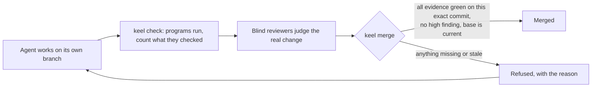
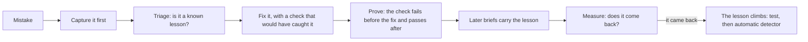

# Keel expansion packs

Keel is an AI team that lives inside a GitHub repository and works for one owner for years. You describe what you want. Keel plans it, shows you what it will make, builds it in small checked steps, and asks you only what a person must decide: money, law, risk and taste.

Today Keel makes software. This repository plans what else it could make: written guides, social graphics, slide decks, videos and other digital products. Each of these is a **pack**. Nothing in this repository is built yet. It holds the plan, the reasons behind it, and two draft pack files that the engine's own checker accepts.

- **[PLAN.md](PLAN.md)**: the detailed plan: which packs, in what order, what the engine must gain first, and the questions only you can answer.
- **[docs/FOUNDER-PATH.md](docs/FOUNDER-PATH.md)**: how one person can use this to build a brand, find clients and earn, starting small.
- **[docs/SOURCES.md](docs/SOURCES.md)**: the facts the plan relies on (platform rules, fees, tool licences, laws), each with its source and how sure we are.
- **[packs/](packs/)**: draft `pack.json` files for the first two packs, `publishing` and `visual`.

The engine itself is in the private repository `partners-pixel/keel-engine`. This repository only reads it and never changes it.

---

## What Keel is

| Keel is | Keel is not |
|---|---|
| A long-lived team process: plan, make, check, release, run, change, retire | A tool that generates something once and walks away |
| A plugin for Claude Code, installed into each project, with its records in that project's git | A hosted service you rent |
| Built for one owner with a usage-limited Claude plan, free GitHub and a slow PC | Built around a big team, paid CI or an always-on server |

You talk to Keel by typing short lines in the Claude chat, on a laptop or on the phone:

```
approve plan
N-0007 B          (answers question N-0007 with option B)
S03 ok            (approves screen S03)
S05 change: smaller bell, less text
pause
```

Every question comes with a recommendation and a safe default. Keel never asks the same thing twice, and it keeps to a weekly budget of about 10 decisions.

## What it gives a one-person owner

- **Your time goes on decisions, not on doing the work.** A normal week takes 2 to 4 decisions, about 15 to 30 minutes in total.
- **You see it before it is built.** Screens (and later slides, pages and graphics) come to a review board where you approve, change or defer each one.
- **"Done" means a program checked it,** not that an AI said so.
- **Mistakes come back less often.** Each one becomes a numbered lesson with a check, and the weekly digest shows how often old mistakes repeat.
- **It fits a small budget.** Cheap models where a program checks the output, strong models only where judgment matters.
- **Your product keeps running without it.** No AI agent holds your production keys; you press release and rollback yourself.

## How the engine is built

### Kernel and packs

Keel has a **kernel**, a general core that knows nothing about any one kind of work, and **packs** that each teach it one kind of work. The kernel reads a pack through one file, `pack.json`. A lint fails if a domain word such as "video", "screen" or "deploy" appears in the kernel.

```mermaid
flowchart TB
  subgraph Kernel["Kernel: knows no domain"]
    L["Loop and state"]
    G["Gates: approvals only you can give"]
    E["Evidence: program results tied to one commit"]
    R["Review items and board"]
    LE["Lessons and learning"]
    H["Hooks and protection"]
  end
  SW["Software pack (today)"] -- pack.json --> Kernel
  PB["Publishing pack (planned)"] -. pack.json .-> Kernel
  VI["Visual pack (planned)"] -. pack.json .-> Kernel
  VD["Video pack (later)"] -. pack.json .-> Kernel
```

A pack declares:

| Part | Software pack example | Publishing pack example (planned) |
|---|---|---|
| Stages | shape, design, build, harden, release | shape, outline, draft, edit, proof, publish |
| Work items | a phase of code | a section, a figure, an edition |
| Evidence that closes an item | tests passed on this exact commit, blind review | every claim has a source, links resolve, the e-book passes its checker |
| Gates (only you decide) | plan, screens, release, production, spending | plan, chapter reads, expert review, publishing, spending |
| Agents | builder, code reviewer, security reviewer | writer, fact-checker, line editor, accessibility reviewer |

### Records

Keel keeps its records (state, decisions, lessons, events) on a separate git branch, `keel/state`, so they never change the product's main branch. Only the `keel` program writes them. Each event carries a fingerprint of the one before it (a *hash chain*), so a hand edit or a merge with no record shows up as an incident.

### Hooks

Hooks are small programs Claude Code runs at fixed moments. Keel uses them to make its rules hold even when an agent forgets them.

| Hook | What it does |
|---|---|
| Session start | Checks the machine, attaches the records, prints a digest of 10 lines or fewer |
| Prompt submit | Records the lines you typed as owner input; only these can approve anything |
| Before a tool runs | Blocks writes to protected files, unknown outside tools and pushes anywhere but the project |
| After a tool runs | Records the exit code the harness saw, so an agent cannot claim a pass |
| Stop | Keeps working while ready work exists; stops when only you can unblock it |

### The merge gate

Finished work joins the main branch only through `keel merge`, which refuses unless every required check passed on that exact commit.



Zero tests is a fail, never a pass. "Not run" is never "passed".

### The learning loop



A lesson can only add or tighten a check. Removing one needs your approval.

## Why you can trust it

- **Programs decide facts; people decide value.** "Passed" is an exit code on one exact commit, not a sentence from an AI.
- **Only you can approve.** An approval is a line you typed in the chat. A GitHub comment, a scheduled prompt or an agent's message never counts.
- **Blind checking.** The verifier never sees the builder's own report; it judges the real change.
- **Least power.** Each agent has a list of the tools it may use. No agent holds a production, payment or publishing credential.
- **Untrusted text is data.** Requirements, web pages and comments are fenced so they cannot approve or start anything.
- **Tamper-evident records.** The hash chain, a copy of its latest fingerprint in every digest, and an independent check before each release make a faked result visible.

**Honest limits.** With one GitHub account, an agent could in principle fake a green check between releases. Keel cannot prevent this; it makes it visible, and the owner accepted this risk in writing (decision F-04). Protection is a guardrail, not a sandbox.

## Beyond software

The same kernel can run other kinds of digital work, as long as a program can check the facts and a person approves the taste and anything public. PLAN.md looks at 15 candidates and ranks them. The short version:

1. **Publishing** first: guides, e-books, documentation and article series. Everything is text in git, and most quality checks are programs. It proves the kernel is really domain-neutral at the lowest cost.
2. **Visual** second: LinkedIn and Instagram carousels, slide decks, thumbnails, brand kits and printables. It reuses the software pack's design tools.
3. **Video** third, once the engine can store big media files outside git.

Building any pack waits until the engine reaches version 1.0 (decision F-18).

## Status

| Part | State on Oct 18, 2026 |
|---|---|
| Keel engine | M0 done; M1 (the trustworthy cloud loop) in progress; 1.0 expected after M6 |
| This repository | Plan, showcase and two draft packs; nothing built |
| Name | "Keel" is a working name; a trademark check comes before any public release |

## Checking the draft packs

The two `pack.json` files and their stack files are checked with the kernel's own rules, read from a keel-engine checkout beside this one:

```
node tools/check-sketches.mjs --engine ../keel-engine
```

It prints the engine commit it checked against, then `ok` or `FAIL` with reasons for each file. Exit 0 means every file passed. Exit 1 means one failed, or none was found (nothing checked is never a pass). Exit 2 means it could not find the engine checkout.

## Rules for this repository

- Never change `partners-pixel/keel-engine` or `partners-pixel/crownglobe-ops`; read them only.
- Fictional data only. No secrets, tokens or real client data, ever.
- Decisions about money, scope and priorities belong to the owner. Plans ask them in one batch, with a recommendation each.
- Work goes on a branch and through a pull request; never directly to `main`.
